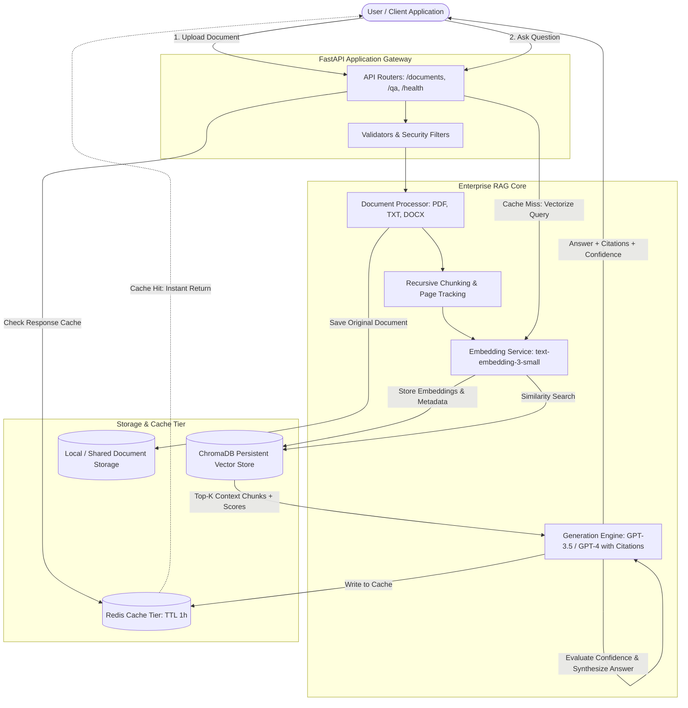

# 🎓 Academic Q&A RAG System

Enterprise-grade Retrieval-Augmented Generation (RAG) platform tailored for academic research, university coursework, and technical literature. Built with **FastAPI**, **LangChain**, **ChromaDB**, **Redis**, and **OpenAI**.

---

## 🏛️ System Architecture



---

## ✨ Key Enterprise Capabilities

1. **Semantic Document Retrieval**: Leverages dense vector embeddings (`text-embedding-3-small`) with cosine similarity indexing in persistent ChromaDB.
2. **Multi-Format Ingestion**: Ingests `.pdf`, `.txt`, and `.docx` files with automated page attribution and table parsing.
3. **Source Citation & Attribution**: Answers include source references with document IDs, document titles, excerpt previews, and exact page numbers.
4. **Resilient Redis Response Caching**: MD5/SHA-256 hashed queries cache generation outputs to reduce API costs and guarantee sub-10ms response times for repeated queries. Gracefully degrades if Redis is unavailable.
5. **Multi-Turn Conversation Memory**: Tracks contextual follow-up questions within dedicated session IDs (`conversation_id`).
6. **Strict Confidence Scoring**: Aggregates retrieval distances into normalized confidence scores (0.0 to 1.0) and rejects queries that fall below `MIN_CONFIDENCE_SCORE`.
7. **Production Observability**: Built-in `/health` and `/health/live` endpoints inspect vector store vector counts, Redis connectivity, and configuration readiness.

---

## 📁 Project Structure

```
academic-qa-rag/
├── app/
│   ├── __init__.py
│   ├── main.py                 # FastAPI app definition & lifespan
│   ├── config.py               # Pydantic v2 Settings & environment loader
│   ├── models.py               # Pydantic schemas (Request/Response)
│   ├── services/
│   │   ├── __init__.py
│   │   ├── document_processor.py # PDF/TXT/DOCX extraction & page mapping
│   │   ├── embedding_service.py  # LangChain chunking & OpenAI embeddings
│   │   ├── retrieval_service.py  # ChromaDB collection management
│   │   ├── generation_service.py # LCEL prompt chain & confidence scoring
│   │   └── cache_service.py      # Resilient Redis cache with TTL
│   ├── routers/
│   │   ├── __init__.py
│   │   ├── documents.py        # Ingestion, listing, and deletion
│   │   ├── qa.py               # RAG question answering & conversation sessions
│   │   └── health.py           # Observability, ChromaDB & Redis status
│   └── utils/
│       ├── __init__.py
│       └── validators.py       # File size, type, and query validation
├── data/
│   ├── documents/              # Local storage for raw uploaded documents
│   └── chroma_db/              # Persistent vector store database
├── .env.example                # Configuration template
├── .env                        # Local configuration file
├── Dockerfile                  # Container definition
├── docker-compose.yml          # Container orchestration (App + Redis)
├── requirements.txt            # Python dependencies
└── README.md                   # Enterprise documentation
```

---

## 🚀 Quick Start Guide

### Option 1: Docker Compose (Recommended for Production / Evaluation)

1. **Configure Environment:**
   ```bash
   cp .env.example .env
   # Edit .env and set your OPENAI_API_KEY
   ```

2. **Launch Services:**
   ```bash
   docker-compose up -d --build
   ```

3. **Verify Health:**
   ```bash
   curl http://localhost:8000/health
   ```

4. **Access OpenAPI Interactive UI:**
   Open [http://localhost:8000/docs](http://localhost:8000/docs) in your browser.

---

### Option 2: Local Python Environment

1. **Create and Activate Virtual Environment:**
   ```bash
   # Windows (PowerShell)
   python -m venv venv
   .\venv\Scripts\Activate.ps1

   # Linux / macOS
   python3 -m venv venv
   source venv/bin/activate
   ```

2. **Install Dependencies:**
   ```bash
   pip install -r requirements.txt
   ```

3. **Set Up Environment Variables:**
   ```bash
   cp .env.example .env
   # Ensure OPENAI_API_KEY=sk-... is configured in .env
   ```

4. **Start Redis (Optional but Recommended for Caching):**
   ```bash
   docker run -d -p 6379:6379 --name redis-cache redis:7-alpine
   ```
   *(Note: If Redis is not running, the application automatically bypasses cache and logs a warning without crashing).*

5. **Start Application:**
   ```bash
   uvicorn app.main:app --host 0.0.0.0 --port 8000 --reload
   ```

---

## 📡 REST API Reference

### 1. Document Management (`/api/v1/documents`)

#### Upload Document
- **Endpoint**: `POST /api/v1/documents/upload`
- **Content-Type**: `multipart/form-data`
- **cURL Example**:
  ```bash
  curl -X POST "http://localhost:8000/api/v1/documents/upload" \
    -F "file=@sample_paper.pdf" \
    -F "title=Introduction to Deep Learning" \
    -F "description=Academic paper covering foundational concepts of neural networks"
  ```

#### List Indexed Documents
- **Endpoint**: `GET /api/v1/documents/list`
- **cURL Example**:
  ```bash
  curl -X GET "http://localhost:8000/api/v1/documents/list"
  ```

#### Delete Document
- **Endpoint**: `DELETE /api/v1/documents/{doc_id}`
- **cURL Example**:
  ```bash
  curl -X DELETE "http://localhost:8000/api/v1/documents/e4b9b94c-8822-446a-8b89-6e3e5734279b"
  ```

---

### 2. Q&A and Multi-Turn Conversations (`/api/v1/qa`)

#### Ask a Question (Single Query or Multi-Turn)
- **Endpoint**: `POST /api/v1/qa/ask`
- **Content-Type**: `application/json`
- **cURL Example**:
  ```bash
  curl -X POST "http://localhost:8000/api/v1/qa/ask" \
    -H "Content-Type: application/json" \
    -d '{
      "query": "How do attention mechanisms improve transformer performance over RNNs?",
      "top_k": 5
    }'
  ```
- **Response Sample**:
  ```json
  {
    "answer": "Attention mechanisms allow transformers to process input tokens in parallel rather than sequentially, mitigating vanishing gradient bottlenecks and capturing long-range semantic dependencies directly [Attention Is All You Need, Page 4].",
    "sources": [
      {
        "doc_id": "1d86f7f2-c9a4-4f51-b841-3b7c02bbdb6d",
        "title": "Attention Is All You Need",
        "chunk_text": "Recurrent models typically factor computation along the symbol positions...",
        "relevance_score": 0.8921,
        "page_number": 4
      }
    ],
    "confidence_score": 0.884,
    "processing_time_ms": 612.4,
    "query": "How do attention mechanisms improve transformer performance over RNNs?",
    "conversation_id": null,
    "cached": false
  }
  ```

#### Start Conversation Session
- **Endpoint**: `POST /api/v1/qa/conversation/start`
- **cURL Example**:
  ```bash
  curl -X POST "http://localhost:8000/api/v1/qa/conversation/start"
  ```

#### Ask with Conversation Context
- Pass the returned `conversation_id` in subsequent questions:
  ```bash
  curl -X POST "http://localhost:8000/api/v1/qa/ask" \
    -H "Content-Type: application/json" \
    -d '{
      "query": "Can you provide an example from the paper?",
      "conversation_id": "893c5d67-4ef8-498b-90f6-f75e7a9bbfcb",
      "top_k": 3
    }'
  ```

#### View Conversation Transcript
- **Endpoint**: `GET /api/v1/qa/conversation/{conversation_id}`
- **cURL Example**:
  ```bash
  curl -X GET "http://localhost:8000/api/v1/qa/conversation/893c5d67-4ef8-498b-90f6-f75e7a9bbfcb"
  ```

#### Cache Statistics
- **Endpoint**: `GET /api/v1/qa/cache/stats`
- **cURL Example**:
  ```bash
  curl -X GET "http://localhost:8000/api/v1/qa/cache/stats"
  ```

---

### 3. Observability & Health Checks (`/health`)

- **Full Health**: `GET /health`
- **Liveness Probe**: `GET /health/live`

---

## ⚙️ Configuration Variables

| Variable | Default | Description |
|---|---|---|
| `OPENAI_API_KEY` | *(Required)* | OpenAI API secret key |
| `MODEL_NAME` | `gpt-3.5-turbo` | OpenAI chat completion model |
| `EMBEDDING_MODEL` | `text-embedding-3-small` | OpenAI vector embedding model |
| `CHROMA_PATH` | `./data/chroma_db` | Storage path for persistent vector store |
| `VECTOR_STORE_NAME` | `academic_qa` | Collection name inside ChromaDB |
| `REDIS_HOST` | `localhost` | Redis host address |
| `REDIS_PORT` | `6379` | Redis TCP port |
| `CACHE_TTL` | `3600` | Response cache expiration in seconds |
| `DOCUMENT_STORAGE_PATH` | `./data/documents` | Storage folder for uploaded documents |
| `MAX_FILE_SIZE` | `52428800` | Maximum upload file size (50MB) |
| `ALLOWED_FILE_TYPES` | `pdf,txt,docx` | Permitted file extensions |
| `CHUNK_SIZE` | `1000` | Text splitter character window |
| `CHUNK_OVERLAP` | `200` | Text splitter overlap window |
| `RETRIEVAL_TOP_K` | `5` | Default number of vector chunks retrieved |
| `MIN_CONFIDENCE_SCORE` | `0.5` | Minimum retrieval score required for answer generation |
| `DEBUG` | `false` | Enable verbose debug logging |
# ragquestionanswer

# ragquestionanswer

